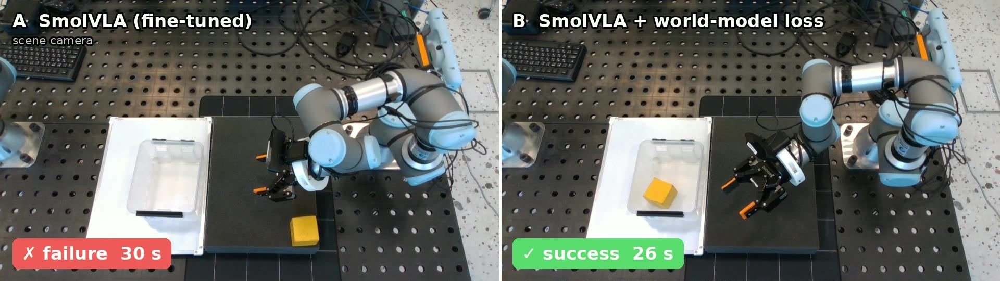
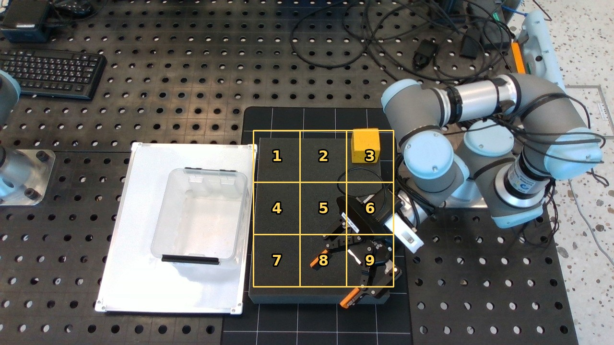

# Distillation-WAM: world-model supervision for a small VLA policy

Which world-model signals does a lightweight vision-language-action policy (SmolVLA, 0.45B) need to act robustly,
and can it learn them at training time only, without running a world model at inference?

We test five candidate signals in simulation (LIBERO, LIBERO-Plus) and on a real UR3 arm. In every training-time
variant the deployed student is a plain SmolVLA: the same weights and the same latency as the baseline.


*Real UR3, cell 9, same start for both policies, scene camera. Left: plain SmolVLA (A) fails. Right: SmolVLA trained with the
world-model loss (B) puts the cube in the box.*

## Signals tested

| # | Signal | How the student gets it | Testbed | Result |
|---|---|---|---|---|
| 1 | Future imagination at inference | Fast-WAM acting with vs without imagined future frames | LIBERO, LIBERO-Plus | not needed: 77.9 vs 77.1% on LIBERO-Plus, 3.9× the latency |
| 2 | Pooled future latent of a WAM | auxiliary head on SmolVLA regresses one averaged future vector of the Fast-WAM teacher | LIBERO, LIBERO-Plus | no measurable gain: +2.0 pp, 95% CI [−2.2, +6.1] |
| 3 | Value / outcome | outcome head on the policy's features | UR3 data | not learnable from our data: cross-session AUROC 0.40–0.43 |
| 4 | **Spatial future latents of a video world model** | auxiliary heads on the scene tokens predict V-JEPA 2 latents 0.5–2 s ahead | UR3, offline + robot | **works**: grounding +0.136, 93% of the gap to π0.5 |
| 5 | Control: big-policy distillation | imitate π0.5's action chunks | UR3, offline | matches π0.5 offline, needs a task-trained 3.6B teacher |

Fast-WAM (a world-action model) is used only in simulation. On the real robot the world-model signal comes from
V-JEPA 2, a self-supervised video model that has never seen actions; only its frozen encoder is used.

## Method

**Arm B (ours).** SmolVLA is trained with its usual flow-matching loss plus an auxiliary loss on the vision-language
backbone's output at the 64 scene-image tokens (an 8×8 grid over the image):

$$\mathcal{L}_B=\mathcal{L}_{\mathrm{FM}}+\lambda\sum_{k\in\{5,10,20\}}\mathrm{smoothL1}\bigl(h_k(z^{\mathrm{scene}}_t),\,\hat y_{t+k}\bigr),\qquad\lambda=0.5$$

$$\hat y_{t+k}=\mathrm{LN}\bigl(\mathrm{pool}_{8\times8}\,\phi_{\text{V-JEPA2}}(x_{t+k})-\mu_{\mathrm{pos}}\bigr)$$

- $x_{t+k}$ is the real scene frame $k$ frames ahead (10 Hz, so 0.5, 1 and 2 s); $\phi_{\text{V-JEPA2}}$ is the frozen
  V-JEPA 2 ViT-L encoder (`facebook/vjepa2-vitl-fpc64-256`, 304M parameters), giving a 16×16 grid of 1024-d latents
  that is pooled to 8×8 so each cell matches one scene token.
- $\mu_{\mathrm{pos}}$ is the per-position mean latent over the training set. Subtracting it removes the static
  background, so the target carries what changes (the arm and the object).
- $h_k$ are small heads, one per horizon. They are removed after training (`strip_wm_heads.py`).
- Targets are computed once in advance (`vjepa_targets.py`); the encoder does not run during training.

**Arm C (control).** SmolVLA distilled from π0.5 fine-tuned on the same data. The flow-matching target is
$\tilde A=m\,A^{\mathrm{teacher}}+(1-m)\,A^{\mathrm{demo}}$ with $m=1$ on deliberate-failure frames and
$m\sim\mathrm{Bernoulli}(0.5)$ elsewhere (teacher share 0.62–0.63).

**Arm A** is the same recipe without any extra loss; **arm D** is π0.5 itself. A, B and C: batch 64, 10k steps,
unfrozen VLM, one A100, about 3.5 h per run.

## Results

### Simulation: signals 1 and 2

| | LIBERO | LIBERO-Plus |
|---|---|---|
| Fast-WAM, imagines 9 future frames | 98.0 | 77.9 |
| Fast-WAM, current frame only | 99.0 | 77.1 |
| SmolVLA, behaviour cloning (3 seeds) | 77.6 ± 2.1 | 40.6 ± 2.9 |
| + pooled Fast-WAM future latent (3 seeds) | 79.4 ± 3.4 | 44.9 ± 1.3 |
| pre-registered replication on 280 new tasks | — | −0.4 pp |
| all 560 tasks, 95% CI | — | +2.0 pp [−2.2, +6.1] |
| shuffled-target control vs behaviour cloning | — | −0.1 pp |

Success rate, %. LIBERO: 200 episodes per Fast-WAM mode; LIBERO-Plus: stratified subsets of 280 tasks with cleaned
instructions, one trial per task. Latency on an A100: 495 ms per step with imagination, 128 ms for SmolVLA.
Details in `results/simulation/`.

### Value head: signal 3

| AUROC | logistic regression | MLP |
|---|---|---|
| validation, after the error moment | 0.997 | 0.998 |
| validation, first frame (should be ≈ 0.5) | 0.964 | 0.845 |
| cross-validation by recording session | 0.43 | 0.40 |

The head recognises the recording session (outcomes were recorded in blocks). Details in `results/value_head/`.

### Offline, real-robot data: signals 4 and 5

Held-out cube episodes (2 sessions, 14 episodes). Means over 2 training seeds (π0.5: 1 seed).

| | A SmolVLA | B + world model | C distilled π0.5 | D π0.5 |
|---|---|---|---|---|
| follow, scene image swapped | 0.768 | **0.903** | 0.941 | 0.914 |
| follow, both cameras swapped | 0.799 | 0.923 | 0.984 | 0.951 |
| start error, mm | 39.9 | 38.8 | 39.4 | 39.7 |
| endpoint error at the grasp, mm (seed 1) | 34.6 | 36.7 | 37.0 | 40.1 |

- B − A = +0.136, 95% CI [+0.088, +0.179], B better on 13 of 14 episodes; gap closed
  $(B-A)/(D-A)=(0.903-0.768)/(0.914-0.768)\approx 0.93$.
- C − A = +0.173 [+0.137, +0.207]; C − B = +0.037 [−0.011, +0.090], no difference.
- The heads predict change: their loss ends at 0.23–0.24, against 0.37 for predicting zero and 0.46–0.50 for copying
  the current frame. The action loss is unchanged (A 0.028, B 0.027).

**Follow** (`code/evaluation/grounding_follow.py`): half a second after the start, plan 3 s ahead with the episode's
own images $I$ and with the images $I_{\mathrm{swap}}$ of the held-out episode whose cube lies farthest away, keeping
the own robot state $s$. With $\Delta p=\pi(I_{\mathrm{swap}},s)-\pi(I,s)$ and $\Delta g=g_{\mathrm{swap}}-g$ the
difference of the two real trajectories, $\mathrm{follow}=\langle\Delta p,\Delta g\rangle/\|\Delta g\|^2$: 1 means
the plan moves exactly as the demonstrations do, 0 means the image is ignored. Confidence intervals: paired bootstrap
over held-out episodes, 20,000 resamples. Raw outputs in `results/offline/`.

### Real robot

UR3 with a Robotiq 2F-85 gripper, top-down scene camera and wrist camera; task: pick up the yellow cube and place it
in the left box, cube placed on a 3×3 grid of cells.



| Session | A SmolVLA | B + world model |
|---|---|---|
| Oct 23, cells 2, 3, 4, 6, 8, 9, last take per cell (paired: same cell, same start seed) | 4/6 | **6/6** |
| Oct 23, all attempts on these cells | 4/8 | 6/10 |
| Oct 21, mixed cells | 1/6 | 7/11 |

- A's successes on cells 3 and 8 needed a drop and a re-grasp. Three of B's four misses happened after the foam pad
  and the box had shifted by about 5 cm during the session; after realignment B succeeded again.
- Cell 1 (far edge of the workspace) fails for both: the gripper closes 118–143 mm above the table instead of 92–101.
- π0.5 (an earlier checkpoint trained on cube data only, Oct 14, not paired with A/B): first attempt 5/9 and 6/9
  over two passes, cells 4–9 8/12, far row 0/3 in the first pass (false force stops near the elbow singularity).
- C and the all-data π0.5 have not been evaluated on the robot yet.

Per-episode log: `results/robot/robot_trials_2026-10-23.csv`.

## Repository layout

```
code/
  training/    train_wmaux.py (arm B), vjepa_targets.py, strip_wm_heads.py, teacher_label.py + train_kd.py (arm C)
  pipelines/   train_A.sh, train_B.sh, train_C.sh: the exact training commands
  evaluation/  grounding_follow.py: the follow / plan-shift metric
  robot/       standalone UR3 utilities: safe homing from a foreign joint configuration, camera alignment checks,
               episode and A/B comparison video rendering
results/
  offline/     per-checkpoint offline evaluation and grounding outputs (JSON)
  simulation/  Fast-WAM, LIBERO-Plus and distillation summaries, pre-registration of the replication
  value_head/  outcome-head analysis
  robot/       per-episode robot trials
figures/
```

## Running

Requirements: LeRobot 0.4.4, PyTorch 2.10, a `transformers` version with `VJEPA2Model`; π0.5 runs in a separate
openpi-compatible environment. Datasets are in LeRobot format with scene and wrist cameras; the training scripts also
read a `phantom_episodes.json` next to the dataset with per-episode metadata (task text, `failure_demo` flag).

```bash
DATA=<dataset> RUN=runs/arm_a bash code/pipelines/train_A.sh
DATA=<dataset> RUN=runs/arm_b TARGETS=targets/vjepa bash code/pipelines/train_B.sh
DATA=<dataset incl. failure demos> TEACHER_CKPT=<pi0.5 checkpoint> TEACH=targets/teacher RUN=runs/arm_c \
  A_STATS=<arm A dataset>/meta/stats.json bash code/pipelines/train_C.sh
python code/evaluation/grounding_follow.py --ckpt runs/arm_b/checkpoints/006000/pretrained_model_plain \
  --data <held-out dataset> --out follow_b.json
```

Data collection, the robot deployment stack and the endpoint-error evaluation tool belong to the lab's internal
codebase and are not included. The training set also contains 35 episodes of a second object that are not evaluated
here.

## Limitations

- Small robot samples (6–11 trials per model over two sessions); offline results from 2 seeds; λ not tuned.
- Signals 2 and 4 differ in three ways at once (source model, target form and attachment point, simulation vs real
  robot), so "dense spatial targets work, a pooled vector does not" is still a hypothesis. The clean test is a pooled
  V-JEPA 2 vector on the same robot data, or spatial targets on LIBERO.
- Arm C saw 37 deliberate-failure demonstrations that A and B did not.
- Every model fails at the far edge of the workspace.
